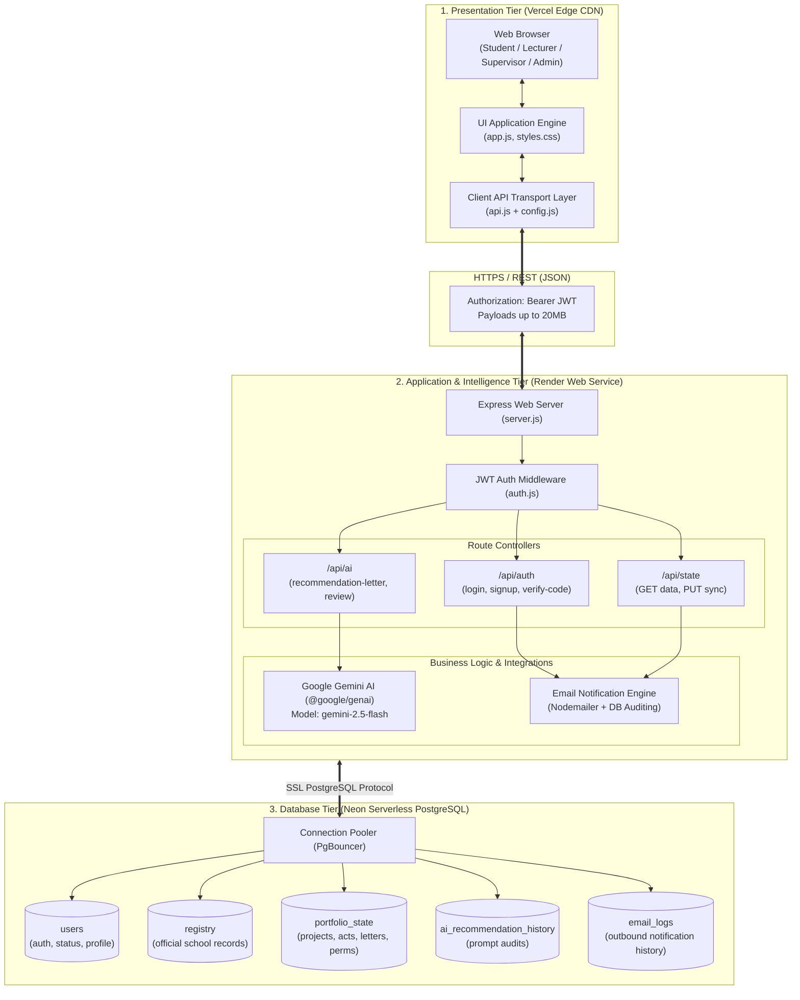

# Africa University Student Recommendation & Portfolio System
## System Architecture & Technical Specification

---

## 1. High-Level System Architecture

The **Africa University Student Recommendation & Portfolio System** is a decoupled, production-grade cloud application built across three tiers:
1. **Frontend Tier (Vercel)**: A high-performance, responsive Single-Page Application (SPA) served via Vercel's global CDN Edge network.
2. **Backend Application Tier (Render)**: A Node.js/Express REST API equipped with JWT authentication, role-based authorization, automated email notifications, and **Google Gemini AI**.
3. **Database Tier (Neon PostgreSQL)**: A serverless cloud PostgreSQL database hosted on AWS (`us-east-2`) with connection pooling (`pgbouncer`), SSL transport enforcement, and JSONB document support.



---

## 2. Complete File & Directory Structure

The project is split into two independent repositories for automated CI/CD deployment:

### 2.1. Frontend Repository: `AURECO_FRONT`
*Deployed to Vercel*

```
AURECO_FRONT/
│
├── assets/
│   ├── favicon.png                  # University crest favicon
│   └── logo.png                     # Africa University institutional seal
│
├── css/
│   └── styles.css                   # Responsive layout, CSS variables, dark/light themes,
│                                    # badge chips, and form controls
│
├── js/
│   ├── config.js                    # Auto-detects environment (Local vs Render)
│   ├── api.js                       # AuAPI client (JWT storage, debounced sync, REST calls)
│   ├── boot.js                      # Pre-bootstrap script (fetches state before rendering)
│   ├── app.js                       # Core SPA logic (views, forms, permissions, state management)
│   ├── hero.js                      # Homepage typewriter effect & progress telemetry
│   └── public.js                    # Public portfolio scroll-reveal animations
│
├── index.html                       # HTML5 entrypoint, semantic tags, modal/toast anchors
├── vercel.json                      # Vercel Edge configuration (rewrites, immutable caching)
├── .gitignore                       # Git ignore rules
├── API.md                           # REST API specification reference
└── README.md                        # Documentation & Vercel deployment instructions
```

### 2.2. Backend Repository: `AURECO_BACK`
*Deployed to Render*

```
AURECO_BACK/
│
├── src/
│   ├── config/
│   │   └── db.js                    # Neon PostgreSQL pool configuration (pg.Pool with SSL)
│   │
│   ├── middleware/
│   │   └── auth.js                  # JWT token verification & role enforcement
│   │
│   ├── routes/
│   │   ├── auth.js                  # POST /api/auth/login, signup, verify-code, logout
│   │   ├── state.js                 # GET /api/state (data load), PUT /api/state (persistence)
│   │   └── ai.js                    # POST /api/ai/recommendation-letter, review, improve
│   │
│   ├── services/
│   │   ├── aiService.js             # Google Gemini AI SDK integration (@google/genai)
│   │   └── emailService.js          # Nodemailer SMTP engine with DB audit logging
│   │
│   ├── db/
│   │   ├── schema.sql               # PostgreSQL DDL table definitions & indexes
│   │   ├── migrate.js               # Database schema migration runner
│   │   └── seed.js                  # Database seeder (creates registry, demo users, portfolio state)
│   │
│   └── server.js                    # Express app, CORS configuration, 20MB JSON limits, healthcheck
│
├── .env.example                     # Environment blueprint template
├── .gitignore                       # Node modules, system caches, and local secrets ignore
├── package.json                     # Node.js dependencies and operational scripts
├── render.yaml                      # Render Blueprint (Infrastructure-as-Code for auto-deploy)
└── README.md                        # Backend documentation & manual deployment guide
```

---

## 3. How Frontend Connects to Backend

### 3.1. Environment Detection (`js/config.js`)
The frontend automatically selects the backend address based on the current hostname:
- **Local Development**: If running on `localhost` or `127.0.0.1`, it targets `http://localhost:5000`.
- **Production (Vercel)**: When accessed on `*.vercel.app` or a custom domain, it connects to your live Render API (`https://aureco-back.onrender.com`).

```javascript
var isLocal = window.location.hostname === 'localhost' || window.location.hostname === '127.0.0.1';
var defaultBase = isLocal ? 'http://localhost:5000' : 'https://aureco-back.onrender.com';

window.AU_CONFIG = {
  USE_BACKEND: true,
  API_BASE_URL: defaultBase,
  ENDPOINTS: {
    login:      '/api/auth/login',
    logout:     '/api/auth/logout',
    signup:     '/api/auth/signup',
    verifyCode: '/api/auth/verify-code',
    state:      '/api/state',
    aiLetter:   '/api/ai/recommendation-letter',
    aiReview:   '/api/ai/portfolio-review',
    aiImprove:  '/api/ai/improve-project'
  },
  SAVE_DELAY_MS: 600
};
```

### 3.2. Authentication & JWT Storage (`js/api.js`)
When a user logs in via `POST /api/auth/login`, the backend issues a signed JWT containing `{ userId, role, email }`.
- The token is securely stored in browser `sessionStorage` (or `localStorage` if "Keep me signed in" is checked).
- All subsequent HTTP requests automatically attach:
  ```http
  Authorization: Bearer <JWT_TOKEN>
  ```
- If the token expires or is rejected (HTTP 401), `AuAPI.onUnauthorized()` automatically logs the user out and redirects to `#/login` with a clean notification.

### 3.3. Debounced Real-Time Synchronization
To guarantee zero typing lag while keeping the database synchronized:
1. Every user action (editing a project, checking an activity, rating a student) immediately updates the in-memory object `window.__spw.S` and updates the DOM.
2. `AuAPI.pushState(S)` starts a **600ms countdown timer**.
3. If more changes occur within 600ms, the timer resets.
4. When the user pauses, a single `PUT /api/state` request is dispatched to Render with the complete updated dataset.

---

## 4. How the Backend Connects to the Database

### 4.1. Neon PostgreSQL Connection Pool (`src/config/db.js`)
The backend communicates with Neon using PostgreSQL connection pooling:
- **Serverless Endpoint**: Connects via `ep-wispy-mode-b44tzo98-pooler.c-6.us-east-2.aws.neon.tech:5432`.
- **SSL Encryption**: Enforced with `{ rejectUnauthorized: false }` for TLS connections.
- **Resource Management**: Uses a connection pool (`max: 10`, `idleTimeoutMillis: 30000`) so idle database connections are gracefully released.

### 4.2. Database Tables
1. **`users`**:
   Stores student, lecturer, supervisor, and administrator profiles. Passwords are encrypted using **bcrypt** (10 salt rounds). Accounts have statuses: `active`, `pending`, `correction`, `rejected`, `deactivated`.
2. **`registry`**:
   The official Africa University student registry. Used during registration to verify school IDs, programs, and student emails.
3. **`portfolio_state`**:
   Singleton JSONB storage holding all projects, extracurriculars, badges, recommendation requests, attachments, supervisor notes, and permissions.
4. **`verification_codes`**:
   Stores 6-digit OTP codes for the 2-step verification flow with expiration timestamps.
5. **`ai_recommendation_history`**:
   Maintains an audit trail of letters and feedback generated by Google Gemini AI.
6. **`email_logs`**:
   Logs every outbound notification (recipient, subject, body, delivery status).

---

## 5. Google Gemini Artificial Intelligence Layer

The AI engine is integrated inside `src/services/aiService.js` using `@google/genai` targeting the `gemini-2.5-flash` model.

### Features:
1. **Automated Recommendation Letter Drafting (`POST /api/ai/recommendation-letter`)**:
   - The faculty member clicks **"✨ AI Draft with Gemini"** in the letter editor.
   - The backend retrieves the student's certified GPA, verified projects, Dean's list awards, and leadership roles.
   - Formulates a structured prompt enforcing Africa University's official academic tone.
   - Gemini generates an impactful, personalized recommendation letter ready for faculty review and signature.
2. **Portfolio Employability Audit (`POST /api/ai/portfolio-review`)**:
   - Evaluates a student's technical stack, achievements, and work experience.
   - Returns structured JSON containing executive summaries, top strengths, recommended improvements, and an **Industry Readiness Score** (1-100).
3. **STAR Project Description Enhancer (`POST /api/ai/improve-project`)**:
   - Rewrites raw project descriptions into structured Situation, Task, Action, and Result (STAR) bullet points.

---

## 6. Email & Notification Subsystem

Located in `src/services/emailService.js`, the notification engine handles:
- **Two-Step Verification Codes**: Dispatches 6-digit OTP codes during student registration.
- **Letter Request Alerts**: Notifies lecturers when a student requests a letter of recommendation.
- **Letter Ready Alerts**: Informs students as soon as a faculty member signs their recommendation.
- **Account Approvals**: Alerts students when the registry office approves their account.
- **Dual Mode Operation**:
  - In production with SMTP configured (`SMTP_HOST`, `SMTP_USER`, `SMTP_PASS`), emails are delivered directly to user inboxes.
  - When SMTP is not configured, it simulates delivery, outputs formatted logs to the console, and records the message in the Neon `email_logs` database table.
